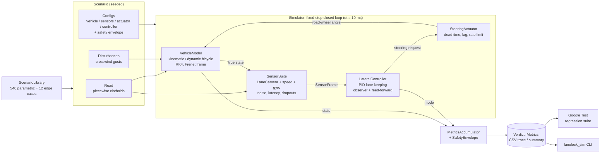

# LaneLock

**Closed-loop ADAS lane-keeping simulator in C++17.**

LaneLock is a simulation framework for testing lane-keeping assist (LKA) control algorithms
without a car. A vehicle model drives a procedurally generated road. A noisy, laggy lane camera
measures where the car sits in its lane, a PID-based lateral controller computes a steering
request, and an electric power steering model applies it. Every run produces safety metrics and a
pass/fail verdict. A library of **552 scenarios** (540 parametric plus 12 edge cases) runs as a
Google Test regression suite, checked against a safety envelope and a recorded metrics baseline.

## Features

- **Vehicle models** integrated with RK4 in road-relative (Frenet) coordinates
  - kinematic bicycle (no tyre slip)
  - linear-tyre dynamic bicycle (sideslip, yaw inertia, understeer)
  - external lateral force input for crosswind gusts
- **Roads** built from piecewise clothoids (straights, arcs, transition curves) with exact
  curvature and integrated world poses
- **Sensors**
  - lane camera with frame rate, latency pipeline, Gaussian noise, bias, random-walk drift,
    quantisation, random burst dropouts and fixed blackout windows
  - the camera reports a clothoid lane model: offset, heading, curvature and curvature rate
  - wheel-speed and gyro yaw-rate sensors
- **Steering actuator**: dead time, first-order lag, rate limit and authority limit
- **PID lane-keeping controller**
  - look-ahead error `e_y + L_a * e_psi`
  - gains re-scheduled with speed so the closed-loop natural frequency and damping stay the
    same at every speed
  - curvature feed-forward with understeer and sideslip compensation
  - filtered derivative on measurement, integrator clamping and back-calculation anti-windup
  - yaw-rate observer that compensates camera latency and bridges dropouts
  - `Active`, `Holding` and `Unavailable` modes for degraded perception and driver handover
- **Metrics and safety envelope**: peak and RMS lateral error, lane-departure detection
  (tyre over the line), steering rate, lateral acceleration, settling time and time spent
  degraded
- **Deterministic**: each scenario carries a seed and each noise source has its own derived RNG
  stream, so every run is reproducible bit for bit

## Architecture



Each simulation step:

1. `SensorSuite` samples the true vehicle state (camera frames are captured at their own rate and
   released after the configured latency).
2. The `LateralController` updates its observer and computes a steering request.
3. The `SteeringActuator` applies dead time, lag, rate and angle limits.
4. The `VehicleModel` integrates one RK4 step with the steering angle and any disturbance force.
5. `MetricsAccumulator` records the step, and the trace callback (if any) receives a `TraceSample`.

### Repository layout

```
include/lanelock/   public headers (road, vehicle, noise, sensors, actuator, pid,
                    controller, metrics, scenario, simulator, io)
src/                implementations (lanelock_core static library)
apps/lanelock_sim.cpp   command-line front end
tests/              Google Test unit, closed-loop and regression suites
baselines/          recorded per-scenario metrics used for regression comparison
.github/workflows/  CI: build + ctest on Linux and macOS
```

## Controller design

For the kinematic bicycle with steering `delta = -kp * (e_y + T_la * v * e_psi)`, the lateral
error dynamics are

```
e_y'' + (v^2 kp T_la / L) e_y' + (v^2 kp / L) e_y = 0
```

Choosing `kp = L wn^2 / v^2` and `T_la = 2 zeta / wn` gives the same natural frequency `wn`
and damping `zeta` at every speed. The defaults are `wn = 1.8 rad/s` and `zeta = 0.9`. The
integral and derivative gains are set as ratios of `kp`. The feed-forward
`(L + K_us v^2) * kappa` is evaluated on the camera's clothoid model a short preview time ahead,
which covers actuator and yaw-response lag. When understeer compensation is on, the
steady-state sideslip `beta_ss(kappa, v)` is removed from the heading error, so steady cornering
is not read as a heading error.

## Scenario library

The parametric grid covers every combination of these dimensions (5 × 6 × 3 × 3 × 2 = 540):

| Dimension | Values |
|---|---|
| Speed | 15, 20, 25, 30, 35 m/s |
| Road geometry | straight, left curve at 1 m/s², right curve at 2 m/s², left curve at 3 m/s², S-curve at 2 m/s², decreasing-radius clothoid (curvature chosen per speed to hit the target lateral acceleration) |
| Sensor quality | ideal, nominal (20 Hz, 50 ms latency, 1% dropouts), degraded (15 Hz, 100 ms, bias, drift, 5% burst dropouts) |
| Initial condition | centred, 0.5 m left, drifting right at 0.4 m/s |
| Disturbance | calm, 500 N crosswind gust pushing towards the outside of the curve |

The 12 edge cases cover a hairpin at 10 m/s, kinematic plants, short and long camera blackouts
(including the handover to `Unavailable`), 200 ms camera latency, a 900 N crosswind, a start
12 cm from the lane line, a camera offset bias, a slow actuator and 20% frame dropout.

The default safety envelope requires no lane departure, max |e_y| ≤ 0.8 m, RMS e_y ≤ 0.5 m,
|a_y| ≤ 5 m/s² and a final |e_y| ≤ 0.4 m.

## How to run

### Requirements

- CMake ≥ 3.16
- A C++17 compiler (GCC 9+, Clang 10+, MSVC 2019+)
- Internet access on the first configure, because CMake fetches GoogleTest v1.14.0 with
  `FetchContent`

You don't need any hardware, credentials or environment variables.

### Build

```bash
cmake -S . -B build -DCMAKE_BUILD_TYPE=Release
cmake --build build --parallel
```

To build only the library and CLI without fetching GoogleTest, pass `-DLANELOCK_BUILD_TESTS=OFF`.

### Use the CLI

```bash
# List scenarios (optionally filtered by substring)
./build/lanelock_sim list curve_left_ay3

# Run one scenario and write a per-step CSV trace (time, pose, errors, steering, controller internals)
./build/lanelock_sim run s_curve_ay2_v30_degraded_offset_left_gust --trace trace.csv

# Run the whole library on all cores, write a summary and compare against the baseline
./build/lanelock_sim suite --summary summary.csv --baseline baselines/metrics_baseline.csv

# Re-record the baseline after an intentional controller change
./build/lanelock_sim suite --write-baseline baselines/metrics_baseline.csv
```

`run` and `suite` exit with a non-zero status when any scenario fails its envelope or regresses
against the baseline, so you can use them directly as CI gates.

### Use it as a library

```cpp
#include "lanelock/scenario.hpp"
#include "lanelock/simulator.hpp"

lanelock::Scenario sc = *lanelock::ScenarioLibrary::find("curve_left_ay3_v25_nominal_centered_calm");
lanelock::Simulator sim(sc, std::make_unique<MyNewController>());  // any LateralController
lanelock::SimulationResult r = sim.run();
std::cout << r.verdict.summary() << " max|e_y|=" << r.metrics.max_abs_lateral_error << "\n";
```

## How to test

```bash
cmake -S . -B build -DCMAKE_BUILD_TYPE=Release
cmake --build build --parallel
ctest --test-dir build --output-on-failure --parallel 8
```

There are two test executables:

- `lanelock_unit_tests` covers math, road geometry, vehicle models, noise and dropout
  statistics, camera latency and blackout, the actuator, PID anti-windup, controller scheduling,
  feed-forward and mode logic, metrics, the envelope and CSV/baseline IO.
- `lanelock_regression_tests` holds the closed-loop behaviour tests (convergence, damping,
  curve tracking on both plants, gust rejection, blackout ride-through, determinism) plus
  `Library/ScenarioRegression.*`, which runs two tests for each of the 552 scenarios:
  - `StaysWithinSafetyEnvelope`
  - `NoWorseThanBaseline`, which compares against `baselines/metrics_baseline.csv` with a
    tolerance of +2 cm or +10% on lateral error. Set `LANELOCK_BASELINE=/path/to.csv` to use a
    different baseline file. When no baseline is found, these tests are skipped.

Useful filters:

```bash
ctest --test-dir build -R unit\\.                 # unit tests only
ctest --test-dir build -R "regression.*degraded"  # degraded-sensor scenarios
./build/tests/lanelock_regression_tests --gtest_filter='*edge_*'
```
